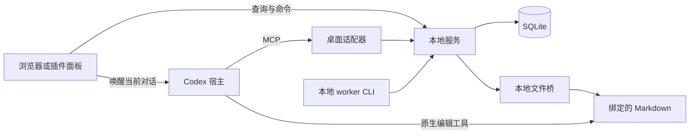

# 架构与状态归属

下图描述参考实现。目录名对应新仓库的文档落点，源码仍在[旧仓库的 `next/`](archive/README.md)。

| 模块 | 职责和入口 |
| --- | --- |
| 面板 | 持有草稿和待核对请求，显示服务投影。[面板参考](../apps/panel/README.md) |
| 本地服务 | 裁决动作、审阅、队列、正式版本和同步计划。SQLite 持久化业务事实。[服务参考](../apps/service/README.md) |
| 本地 worker | 提供可控执行入口，用原上下文领取、捕获和恢复工作。[worker 参考](../apps/worker/README.md) |
| 桌面适配器 | 将当前对话的工具调用接入同一服务。[宿主参考](../plugins/desktop/README.md) |
| 共享包 | [运行时契约](../packages/contracts/README.md)校验边界数据，[文本工具](../packages/text/README.md)处理原文和偏移。 |

工作正文、正式版本及已核对的文件检查点由服务记录。原文件是实际文件内容的来源。面板保存本机草稿，Codex 宿主持有自己的消息与轮次状态。消息被宿主接收、任务被领取、文件被核对是不同的事实。

服务的领域和应用层通过端口连接 SQLite 和文件操作。HTTP、MCP、CLI 都进入服务用例。面板依赖共享契约和文本工具，服务负责裁决业务状态。
