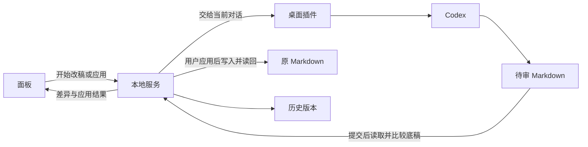

# 代码分工

面板收集用户的批注和审阅选择。本地服务保存本轮底稿、Codex 交回的待审稿和历史版本。桌面插件把生成任务交给当前 Codex 对话。Codex 写待审文件，用户点应用后由本地服务写回原文件。

| 问题 | 负责的部分 |
| --- | --- |
| 怎么保存输入、看差异、改变选择？ | [面板](../apps/panel/README.md) |
| 怎么保存本轮内容、写回原文件、登记版本？ | [本地服务](../apps/service/README.md) |
| 怎么让当前对话拿到任务并提交待审稿？ | [桌面插件](../plugins/desktop/README.md)和[本地执行工具](../apps/worker/README.md) |
| 怎么传数据和计算差异？ | [接口约定](../packages/contracts/README.md)和[文本工具](../packages/text/README.md) |

本轮底稿可能包含还未写到磁盘的人类编辑。生成差异时用底稿比较，应用后读回原文件核对写入结果。实际领到任务后才显示正在改稿。
