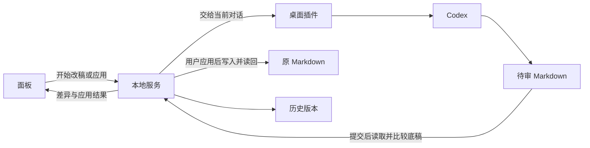

# 代码分工

面板收集用户的批注和审阅选择。本地服务保存本轮底稿、Codex 交回的待审稿和历史版本。桌面插件把生成任务交给当前 Codex 对话。Codex 写待审文件，用户点应用后由本地服务写回原文件。

| 问题 | 负责的部分 |
| --- | --- |
| 怎么保存输入、看差异、改变选择？ | [面板](../apps/panel/README.md) |
| 怎么保存本轮内容、写回原文件、登记版本？ | [本地服务](../apps/service/README.md) |
| 怎么让当前对话拿到任务并提交待审稿？ | [桌面插件](../plugins/desktop/README.md) |
| 怎么用配置模拟 Codex 改稿？ | [开发场景](../dev/mock/README.md)和[脚本执行器](../apps/worker/README.md) |
| 怎么传数据和计算差异？ | [接口约定](../packages/contracts/README.md)和[文本工具](../packages/text/README.md) |

本轮底稿可能包含还未写到磁盘的人类编辑。生成差异时用底稿比较，应用后读回原文件核对写入结果。实际领到任务后才显示正在改稿。

这些目录是根 npm 包中的源码模块，当前不分别安装或发布。`apps/worker` 目前只提供开发用的脚本执行器，不是独立的生产 agent 服务。目录层次与命名规则见[仓库与命名约束](repository-workflow.md#源码层次与命名)。

## 面板与开发场景

浏览器与桌面宿主使用同一套面板。PanelTransport 保持异步读取与命令边界。面板控制器管理输入缓冲、命令顺序和临时显示状态，服务管理已确认的工作稿、任务、审阅、写入证据与版本。

生成、审阅和保存都携带身份。停止后结果发布失效，执行结束未知时仍保留原执行记录。写入成功回执携带原操作与输入来源，不能把较晚的工作稿标为已保存。版本采用分别记录工作稿基点与最新磁盘版本。

mock 使用独立配置和启动入口，复用真实服务。脚本执行器领取真实任务、修改真实候选文件并提交，写回只落在临时文稿副本。示例、规则与失败配置不进入生产面板。原型 notebook、浏览器模拟原文件和历史 schema 迁移不成为第二份业务实现。

[开发运行资源](../dev/runtime/README.md)统一分配 mock 与测试的受管目录，由创建者释放或记录保留原因。它不持有文稿业务状态，也不清理用户显式指定的文件或运行目录。

[接入取舍](decisions/ink-integration.md) · [接入证据](../evidence/ink-integration/README.md)
